# NanoRacer-Beta
Descargas de NanoRacer Beta.

**NanoRacer** es una aplicación para Windows que acompaña tus sesiones de sim racing en iRacing: abre tus programas en orden con un clic y muestra overlays en pantalla mientras corres.

- **Overlays:** Relative, Leaderboard, Combustible (parada, ventana de parada, aviso de ahorro), Sesión y Telemetría.
- **Spotter por voz** en español (**en pruebas**).
- **Análisis** de tus vueltas y telemetría guardada, resultados y récords.

## Estado: BETA
NanoRacer está en fase **beta**: puede tener errores y cambiar entre versiones. El **spotter por voz está en pruebas**: puede fallar o avisar mal, y seguimos trabajando en él.

**Ya no hace falta contraseña ni código de activación:** descarga el instalador y úsalo.

- **Descargar:** sección [Releases](https://github.com/davidlaredo59-cmd/NanoRacer-Beta/releases/latest) → `NanoRacer_Beta_Setup.exe`.
- `version.json` lo lee NanoRacer Beta al abrirse para avisar de versiones nuevas.

## Capturas

### Panel principal
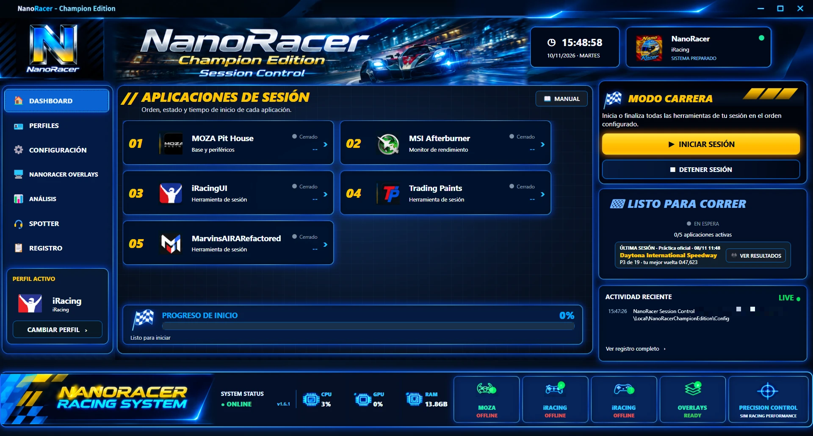
*Dashboard: abre tus programas de sesión en orden con un clic.*

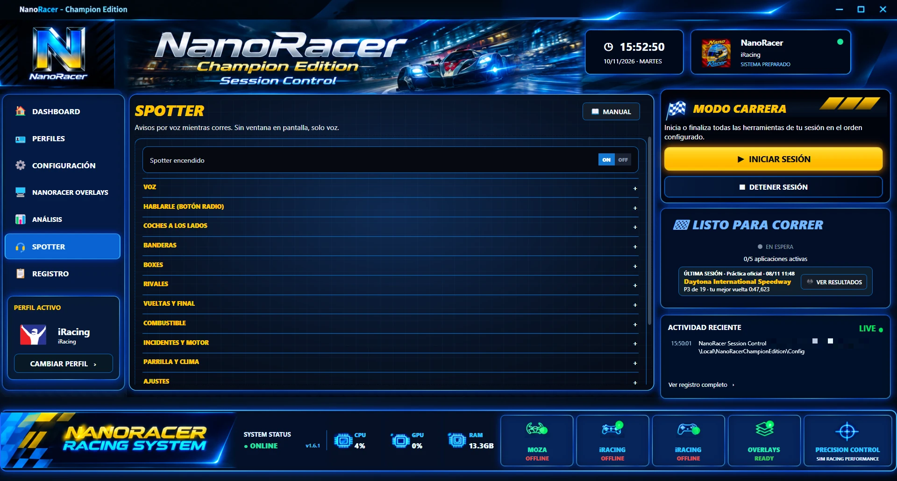
*Spotter por voz (en pruebas): avisos configurables.*

### Overlays
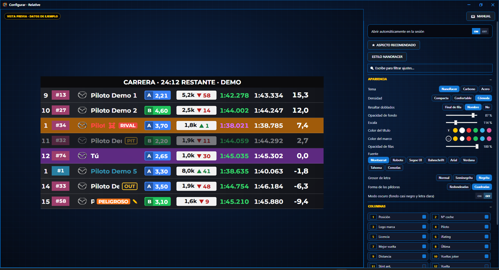
*Relative: los coches de delante y detrás de ti.*

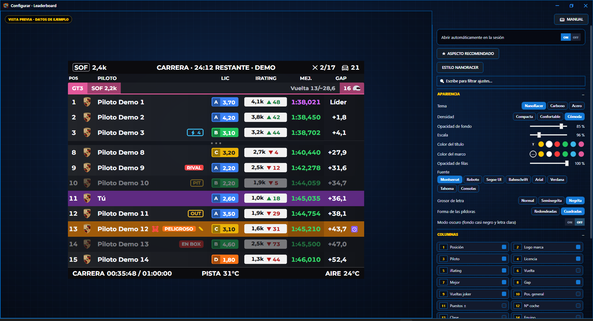
*Leaderboard: la clasificación en vivo, por clases.*

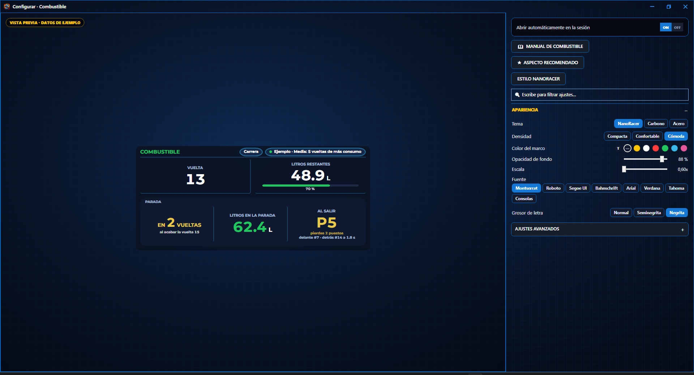
*Combustible: parada, ventana de parada y aviso de ahorro.*

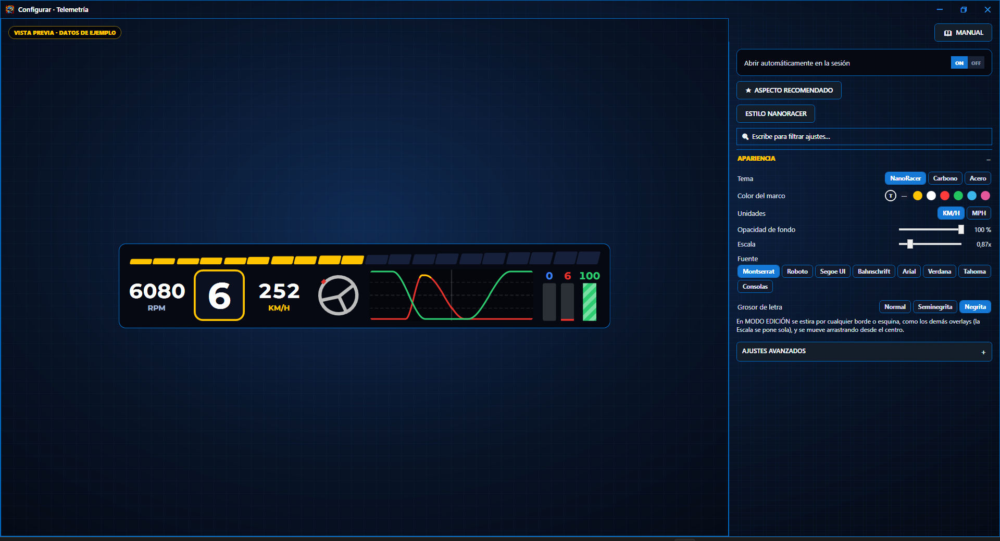
*Telemetría: marcha, RPM, volante y pedales.*

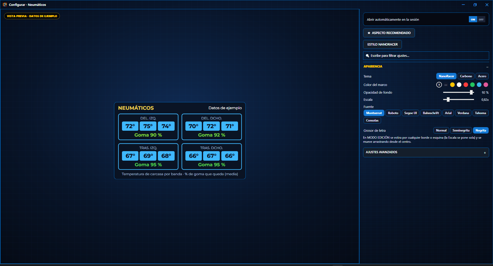
*Neumáticos: temperatura por banda y goma que queda.*

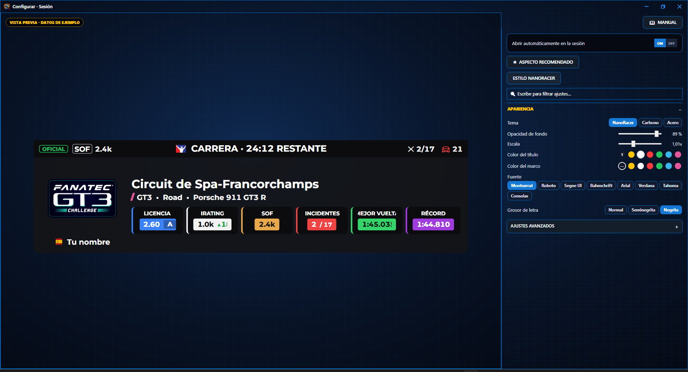
*Información de sesión: circuito, licencia, iRating, SOF e incidentes.*

### Análisis
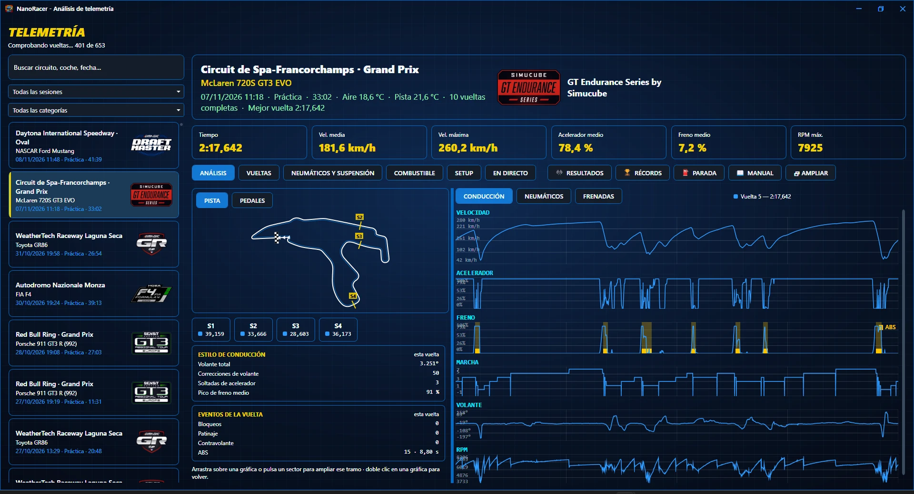
*Análisis de tus vueltas: pista, velocidad, pedales, marcha y volante.*

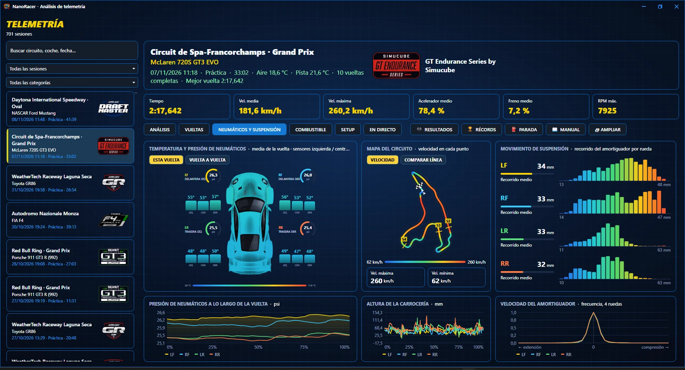
*Neumáticos y suspensión de cada vuelta.*

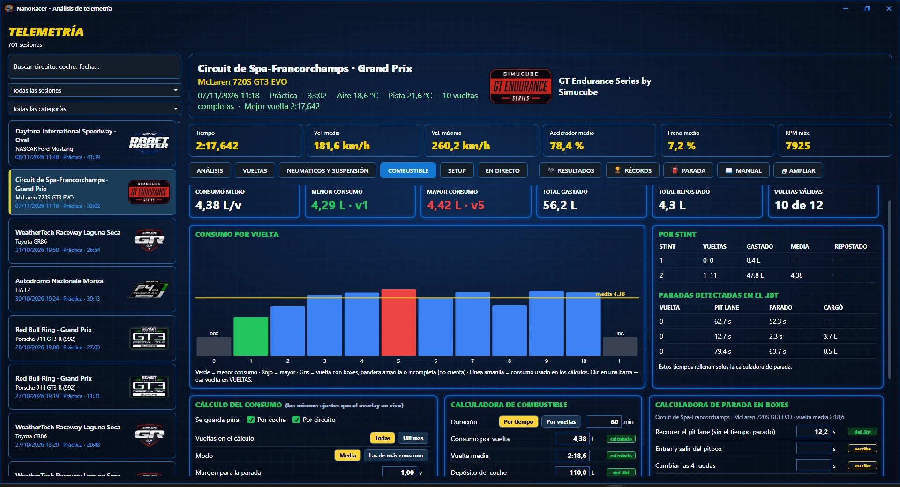
*Consumo por vuelta y calculadoras de combustible y de parada.*

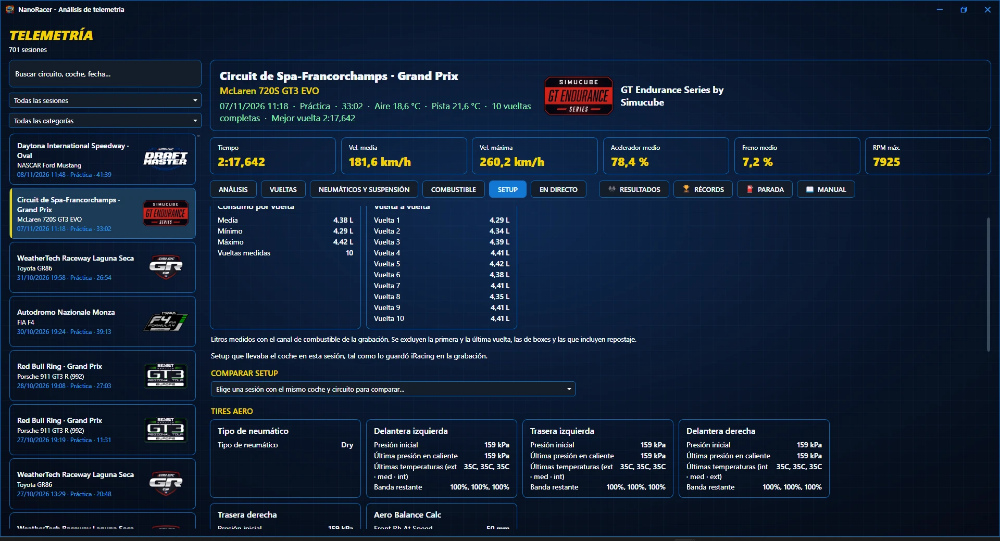
*Setup del coche tal como lo guardó iRacing.*

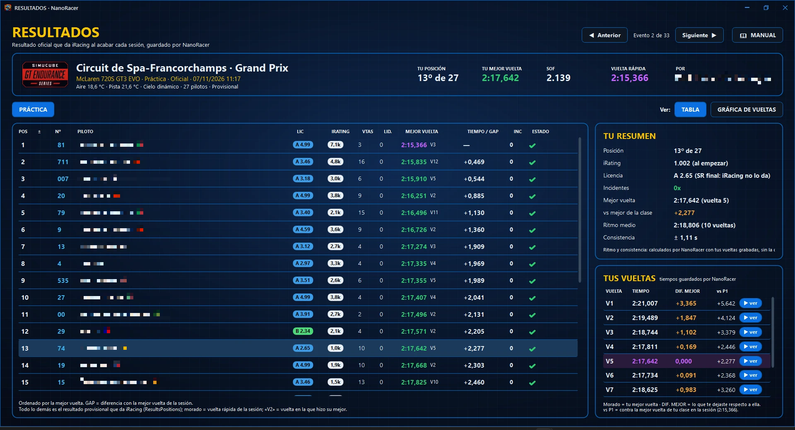
*Resultados oficiales de cada sesión, guardados por NanoRacer.*

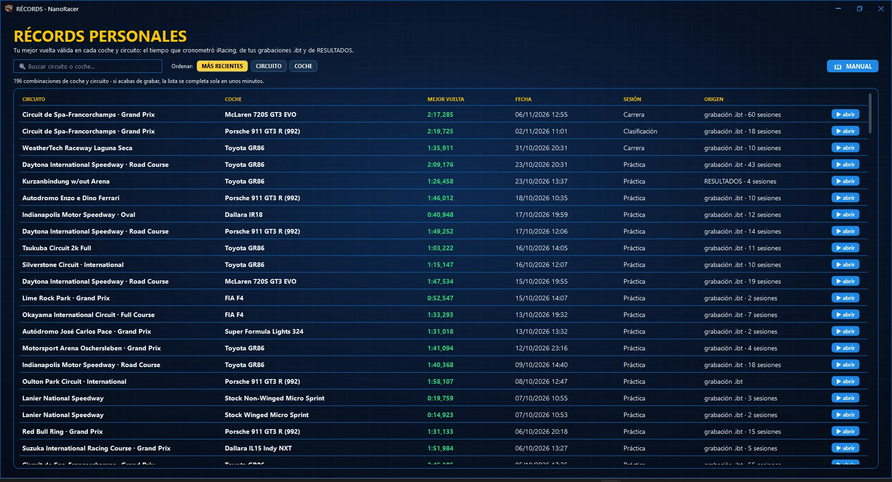
*Tus récords personales por coche y circuito.*

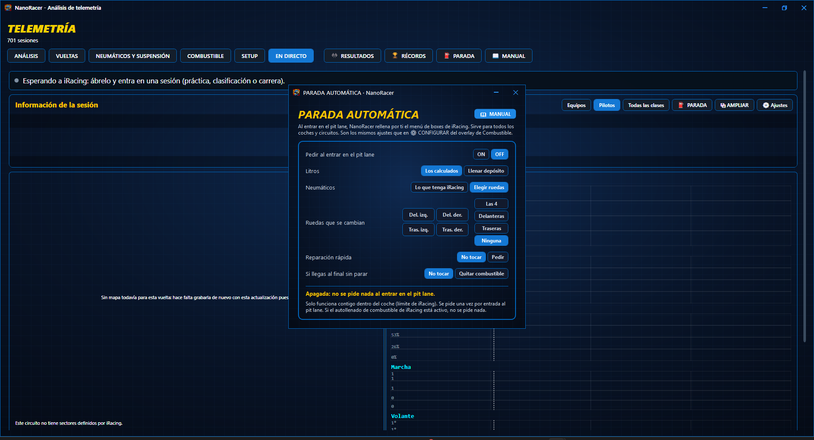
*Parada automática: NanoRacer rellena el menú de boxes por ti.*

## Dudas y errores
Escríbenos en nuestro **Discord**: https://discord.gg/n96cFhPW6Q

Cuéntanos qué ha pasado y, si puedes, adjunta una captura.

## Precio
NanoRacer es gratuito.

## Aviso
NanoRacer es un proyecto independiente. **No está afiliado, patrocinado ni aprobado por iRacing.com Motorsport Simulations, LLC**, ni por ninguna otra marca o programa que se mencione. iRacing y el resto de nombres y marcas pertenecen a sus dueños y se citan solo para indicar con qué funciona la app.

NanoRacer lee los datos de telemetría que iRacing ofrece a programas externos y, si activas la parada automática o la parada por voz, le envía las órdenes de boxes por esa misma vía oficial. No modifica el programa de iRacing.

Se ofrece tal cual, sin garantías: es una versión beta, úsala bajo tu propia responsabilidad.
